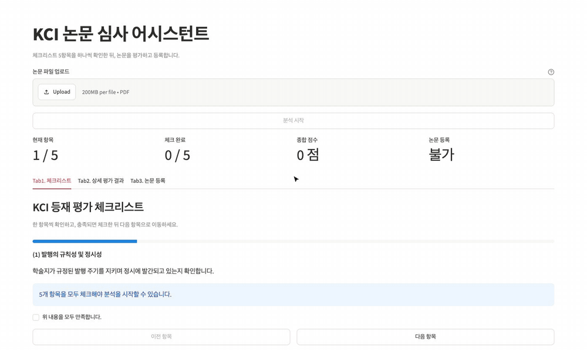
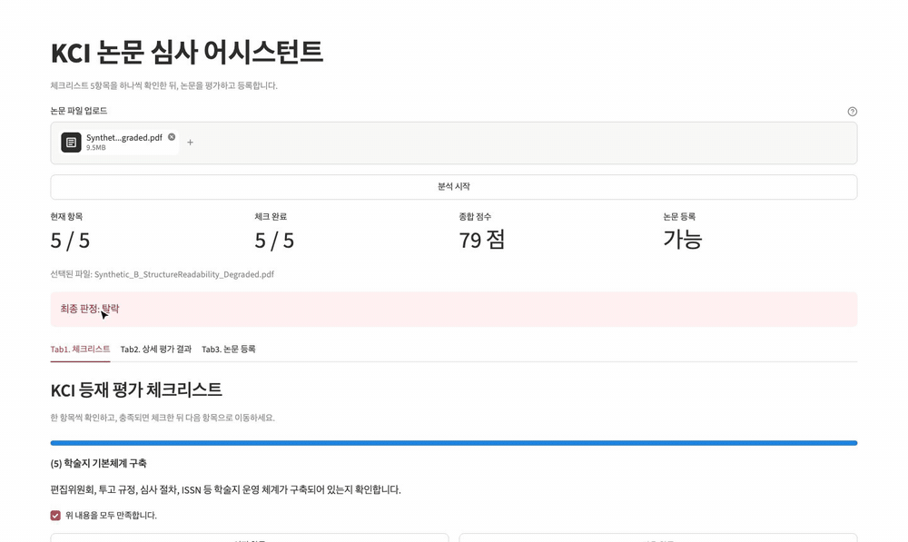
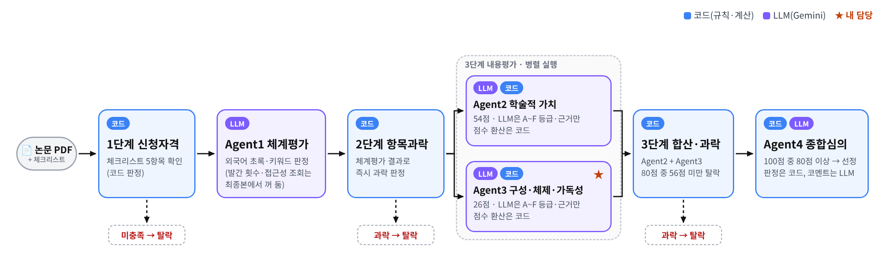

# KCI 등재후보학술지 심사 지원 Multi-Agent

> 학술지 논문 PDF와 신청 체크리스트를 넣으면, KCI 등재후보학술지 평가 기준(신청자격 → 체계평가 → 내용평가 → 종합심의)을 단계별로 적용해 **항목별 등급·근거·점수와 선정 여부 초안**을 만들어 주는 LangGraph 멀티 에이전트입니다.
> 점수는 LLM이 아니라 코드가 계산합니다. LLM은 항목마다 A~F 등급과 근거 문장만 냅니다.

성균관대 × LS AI 교육과정 팀 프로젝트 · 2026.09

| 항목 | 내용 |
|---|---|
| 기간 | 2026.09 |
| 팀 구성 | 에이전트 단위로 역할 분담 |
| 내 역할 | Agent3 구성·체제·가독성 평가 + 합성 평가 데이터 설계·검증 |
| 스택 | Python · LangGraph · LangChain · Gemini · Pydantic · Streamlit · pdfplumber |

<br>

## 시연

| 체크리스트 → 분석 | 상세 평가 리포트 |
|---|---|
|  |  |
| 신청자격 5항목을 확인하고 논문 PDF를 올리면 그래프가 단계별로 실행되어 최종 판정이 나옵니다 | 단계별 점수와 항목별 등급·근거. 합성 B(구성·가독성 훼손) 논문은 Agent3에서 구성·체제 완전성 E, 가독성 E로 감점됩니다 |

<br>

## 처리 흐름



- **관문(신청자격·항목과락·합산 과락)은 코드**로 판정합니다. 기준 미달이면 그 자리에서 탈락하고 다음 에이전트를 부르지 않습니다.
- **Agent2(학술적 가치 54점)와 Agent3(구성·체제·가독성 26점)는 병렬**로 실행되고, 합산 80점 중 56점 미만이면 탈락합니다.
- **Agent1**은 외국어 초록·주제어를 Gemini로 판정합니다. 발간 횟수(Tavily)·온라인 접근성(OpenAlex) 조회 도구도 있지만, 화면에서 학술지 ISSN을 받지 않아 최종본에서는 이 두 항목을 꺼 두고 통과로 처리합니다.
- **Agent4**는 100점 중 80점 이상이면 선정으로 판정(코드)하고, 심의 코멘트만 LLM이 씁니다.

<br>

## 내 역할

| 구분 | 한 일 | 코드 |
|---|---|---|
| Agent3 구성·체제·가독성 (26점) | 세부 3항목(구성·체제 완전성, 가독성, 저자 소속·직위 표기)을 평가하는 에이전트 구현. LLM은 `with_structured_output`으로 항목별 A~F 등급과 근거만 내고, 점수는 `GRADE_TO_RATIO × 항목 배점`으로 코드에서 계산 | [`agents/agent3_structure.py`](agents/agent3_structure.py) |
| 등급은 LLM, 점수는 코드 | LLM이 점수를 직접 매기면 근거와 점수가 맞는지 확인할 방법이 없음 → 등급(범주)과 근거만 받고 환산은 코드로 고정. 이 방식이 Agent2에도 같은 패턴으로 쓰임 | [`config.py`](config.py) `GRADE_TO_RATIO` |
| 합성 평가 데이터 설계 | 정답이 없는 평가라 "에이전트가 맞게 보는지" 확인할 기준이 필요 → 원본 논문 하나를 의도적으로 훼손한 3종 설계: **A** 학술적 가치만 훼손, **B** 구성·가독성만 훼손, **C** 둘 다 훼손 | [`data/README_합성데이터_설계_v2.md`](data/README_합성데이터_설계_v2.md) · `data/Synthetic_*.pdf` |
| B 재설계 (v2) | 첫 B안은 Agent3 점수가 A와 구분되지 않음 → 훼손 방식을 구성·체제·소속 표기 쪽으로 다시 설계해 분리되게 함 | 같은 문서 |
| Agent3 단독 검증 | 원본·A·B·C를 Agent3에 넣어 기대 방향(원본≈A > B≈C)대로 점수가 나오는지 확인 | [`agent3_test.py`](agent3_test.py) |

<br>

## 검증 결과

원본 논문과 합성 데이터 3종을 각각 3회 실행한 평균입니다 ([`AGENT2_REPORT.md`](AGENT2_REPORT.md)).

| 입력 | Agent2 학술적 가치 (/54) | Agent3 구성·가독성 (/26) | 합계 (/80) |
|---|---:|---:|---:|
| 원본 | 54.0 | 22.8 | 76.8 |
| 합성 A (학술적 가치 훼손) | 45.5 | **23.1** | 68.6 |
| 합성 B (구성·가독성 훼손) | 54.0 | **19.0** | 73.0 |
| 합성 C (둘 다 훼손) | 45.5 | **18.6** | 64.1 |

- 3회 모두 기대한 방향이 유지됐습니다. Agent2는 원본≈B > A≈C, Agent3는 원본≈A > B≈C로 **두 에이전트가 서로의 영역을 침범하지 않고 자기 항목만 감점**했습니다.
- 한계: Agent3의 B 점수는 실행마다 17.9~19.9로 흔들렸습니다. 또 12회 모두 3단계 과락 기준(56점)을 넘어, **과락 관문 자체는 이번 데이터로 검증되지 않았습니다.** 기준 근처의 훼손 사례를 더 만들어야 확인할 수 있습니다.

<br>

## 설계에서 정한 것

| 결정 | 이유 |
|---|---|
| 관문은 코드, 평가는 LLM | 체크리스트·과락·합산처럼 규칙이 정해진 판정은 LLM에 맡길 이유가 없음. 재현성과 설명 가능성 확보 |
| LLM은 등급만, 점수는 코드 | 배점·환산 규칙을 코드 한 곳(`config.py`)에 두어, 기준이 바뀌어도 프롬프트를 고치지 않음 |
| Agent2·Agent3 병렬 | 서로 독립된 항목이라 순서가 필요 없음. LangGraph 분기로 동시에 실행하고 합산 노드에서 모음 |
| 탈락 시 즉시 종료 | 앞 단계 탈락이면 뒤 에이전트(LLM·외부 API) 호출 비용을 쓰지 않음 |
| temperature 0 + 구조화 출력 | 등급이 A~F 밖으로 나가거나 형식이 깨지지 않도록 Pydantic 스키마로 강제 |

<br>

## 실행

```bash
pip install -r requirements.txt
cp .env.example .env   # GEMINI_API_KEY 입력
streamlit run app.py
```

`.env` 항목:

```
GEMINI_API_KEY=...
TAVILY_API_KEY=...         # 위와 같음
OPEN_ALEX_API_KEY=...      # 발간 횟수·접근성 조회 (최종본에서는 꺼 둠, 비워도 실행됨)
GEMINI_MODEL_NAME=gemini-3.7-flash   # 선택
```

에이전트 단독 실행: `python agent3_test.py` (원본 논문 `data/Real_Paper.pdf`는 저작권 때문에 저장소에 넣지 않았습니다. 직접 넣어야 원본 비교가 실행됩니다.)

<br>

## 구조

```
app.py                 Streamlit 화면 (체크리스트 → PDF 업로드 → 상세 리포트)
graph.py               LangGraph 흐름: 관문 노드, 병렬 분기, 합산
state.py               공유 상태(KCIEvalState), 등급 타입
config.py              배점·과락 기준·등급 환산표, 모델 이름
agents/
  agent1_foreign_lang.py   체계평가 (외국어 초록·키워드. 발간 횟수·접근성은 꺼 둠)
  agent2_academic_value.py 학술적 가치 (54점)
  agent3_structure.py      구성·체제·가독성 (26점)  ← 내 담당
  agent4_final_decision.py 종합심의 (판정 코드 + LLM 코멘트)
  tools/                   OpenAlex · Tavily 조회 도구
data/                  합성 평가 데이터와 설계 문서  ← 내 담당
```
